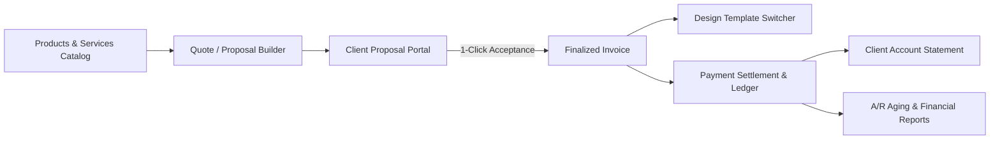
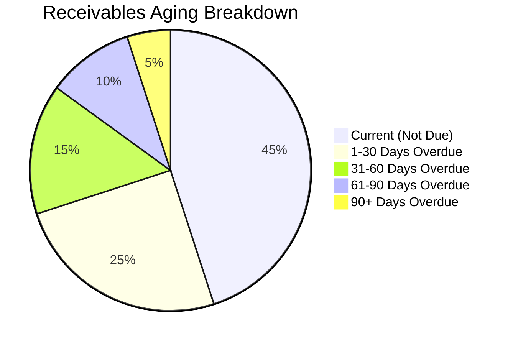

# SwiftCent Platform Feature Document & Stakeholder Presentation Guide

> **Enterprise Billing, Multi-Entity Management & Quote-to-Cash Engine**  
> *Prepared for Executive Stakeholders & Product Review*  
> **Platform Version**: 1.0.0 Pro | **Architecture**: Next.js 16 (App Router), React 19, Tailwind CSS v4, MongoDB  

---

## Executive Summary

**SwiftCent** is a modern, high-precision billing and invoicing platform engineered for multi-entity businesses, agencies, and consultancies. It unifies the entire quote-to-cash lifecycle into an intuitive, auditable workflow—from proposal creation and client acceptance, through line-item catalog invoicing, customizable design templates, and real-time accounts receivable (A/R) aging reports.

### Key Value Propositions
* **Strict Multi-Entity Isolation**: Switch seamlessly between distinct businesses or subsidiaries, each maintaining isolated financial books, client lists, invoice prefixes, and branding.
* **Deterministic Financial Engine**: Zero floating-point rounding errors. All transactions, taxes, and discounts are computed in exact integer cents using an audited mathematical model.
* **Frictionless Client Experience**: Tokenized, secure public client portals allow clients to review proposals, accept quotes, view itemized invoices, and download lifetime account statements without account creation or password friction.
* **Executive Financial Visibility**: Real-time receivables aging schedules, client revenue concentration indices, proposal conversion funnels, and one-click CSV financial exports.

---

## Core Feature Catalog by Functional Pillar

---

### Pillar 1: Multi-Entity & Workspace Architecture

SwiftCent is designed from the ground up to support holding companies, multi-brand agencies, and serial entrepreneurs managing multiple legal entities under a single account.

| Capability | Specification | Stakeholder Benefit |
| :--- | :--- | :--- |
| **Workspace Isolation** | Dynamic workspace tenancy keyed by `organizationId`. Clients, invoices, and catalog items never leak across entities. | Complete privacy and compliance across distinct businesses. |
| **Custom Identity & Branding** | Custom logo upload, primary brand hex color, legal address, contact email, and official Tax ID / EIN per entity. | Every document sent looks bespoke and strictly matches the entity's corporate identity. |
| **Sequential Prefix Control** | Custom invoice prefixes (e.g., `APX-`, `INV-`) and quote prefixes (e.g., `QTE-`) with gap-less sequential numbering. | Satisfies international tax and accounting statutory requirements. |
| **Instant Workspace Switcher** | Global header dropdown enables switching active entities with zero page reload latency. | Efficient management without needing multiple browser tabs or logins. |

---

### Pillar 2: Products & Services Catalog Hub

A centralized deliverables library that eliminates repetitive manual data entry and enforces company-wide pricing consistency.

* **Dedicated Hub Route**: `/products` (under `FINANCE` in the primary navigation).
* **Catalog Management**: Instant search, addition, editing, and deletion of standard deliverables, hourly rates, and fixed retainer packages.
* **Pricing & Tax Presets**: Each catalog item stores a pre-configured unit price (integer cents), default tax rate, and tax calculation method (`exclusive` vs. `inclusive`).
* **1-Click Auto-Fill**:
  * Integrated directly into both the **Invoice Builder** (`/invoices/new`) and **Quote Builder** (`/quotes/new`).
  * Selecting an item from the catalog dropdown instantly populates the item description, unit price, and applicable tax rates into the draft document.

---

### Pillar 3: Quote & Proposal Pipeline (Quote-to-Cash)

Streamlines the proposal process from drafting through formal client acceptance and automated invoice generation.

* **Proposal Authoring**: Build detailed multi-item scope of work proposals with customizable validity dates and terms of acceptance.
* **Public Client Approval Portal (`/portal/quotes/[token]`)**:
  * Secure, token-gated link sent directly to the client.
  * No login required: clients can review line items, unit rates, and totals.
  * **Interactive Accept & Authorize**: Clients can formally accept the quote online, timestamping the acceptance record.
* **1-Click Conversion to Invoice**:
  * Once accepted (or directly by an administrator), clicking **"Convert to Invoice"** automatically creates a finalized invoice carrying over all line items, client snapshots, and pricing data.
  * Maintains bi-directional links between the original quotation and the generated invoice.

---

### Pillar 4: Invoice & Quote Design Templates

Delivers agency-grade presentation standards through dynamic layout themes and interactive branding palettes.

#### Available Layout Themes:
1. **Modern Clean**: Contemporary SaaS layout featuring clean sans-serif typography, structured data cards, and refined status pills.
2. **Corporate Formal**: Traditional enterprise layout with serif accents, boxed credential headers, and classic double-underline accounting total ledgers.
3. **Creative Studio**: High-contrast modern layout featuring a bold dark top banner, stylized invoice numerals, and contemporary grid alignment.

#### Dynamic Customization:
* **Interactive Accent Switcher**: Live palette switcher supporting 5 executive colors (*Royal Blue, Emerald, Indigo, Slate, Amber*).
* **Smart Print Suppression**: The layout and color switcher automatically hides when printing (`@media print`) or exporting to PDF, ensuring zero visual clutter.
* **Universal Deployment**: Available across internal admin detail views (`/invoices/[id]`, `/quotes/[id]`) and public client-facing links (`/portal/[token]`, `/portal/quotes/[token]`).

---

### Pillar 5: Precision Financial Calculations & State Machine

Guarantees accounting accuracy and audit compliance through formal mathematical modeling.

* **Integer-Cent Math**: All monetary values are calculated and persisted as exact integer cents (`amountCents`). Prevents floating-point rounding errors common in standard web applications.
* **Comprehensive Tax & Discount Rules**:
  * Percentage and fixed amount discounts applied at the line-item or document level.
  * Strict handling of both **Exclusive Taxes** (tax added on top of subtotal) and **Inclusive Taxes** (tax extracted from gross price).
* **Deterministic State Machine**:
  * Invoices transition predictably through: `draft` $\to$ `sent` $\to$ `viewed` $\to$ `partially_paid` $\to$ `paid` $\to$ `overdue` $\to$ `void`.
  * **Immutable Document Locking**: Once marked as `sent` or `paid`, core line items are locked from tampering to protect accounting ledger integrity.
* **Immutable Activity & Audit Timeline**: Every state change, client dispatch, view event, and payment recorded is appended to a tamper-proof audit trail displayed on the document.

---

### Pillar 6: Dedicated Financial & Receivables Analytics

An executive reporting dashboard (`/reports`) providing real-time visibility into cash flow, aging balances, and customer concentration.

* **Executive KPI Metric Cards**:
  * **Total Invoiced**: Cumulative gross billing volume across all issued documents.
  * **Collected Revenue**: Cleared payments credited to date.
  * **Outstanding Receivables**: Real-time balance awaiting settlement.
  * **Weighted Average Aging**: Average days outstanding across active receivables.
* **A/R Aging Schedule**:
  * Categorizes all open receivables into standard accounting aging buckets: **Current**, **1–30 Days**, **31–60 Days**, **61–90 Days**, and **90+ Days Overdue**.
  * Features a color-coded proportional distribution bar.
* **Client Revenue Concentration Index**:
  * Ranks clients by total revenue generated.
  * Calculates each client's percentage share of the company's total billing, identifying key accounts and revenue dependency risks.
* **Quote Pipeline & Conversion Funnel**:
  * Quantifies total proposal pipeline volume versus accepted work.
  * Displays the company's real-time **Acceptance Win Rate %**.
* **Tax Liability Summary**:
  * Tracks total taxable sales and net tax liabilities accrued across active jurisdictions.
* **One-Click CSV Export**:
  * Downloads a structured, itemized CSV dataset ready for import into QuickBooks, Xero, or corporate spreadsheets.

---

### Pillar 7: Client Document Archive & Account Statement

Provides enterprise clients with a self-service transparency portal, eliminating back-and-forth emails requesting past invoices.

* **Dedicated Client Route**: `/portal/statement/[token]`
* **Client-Facing Account Summary**:
  * **Lifetime Invoiced**: Total amount billed across the history of the account.
  * **Total Paid**: Total payments credited.
  * **Current Account Balance**: Net outstanding balance requiring settlement.
* **Unified Document Ledger**:
  * Lists all historical invoices with issue dates, due dates, statuses, and individual balances.
  * Lists all proposals and quotations with validity windows and approval statuses.
* **Bank & Settlement Instructions**:
  * Displays wire transfer, ACH routing, and bank settlement instructions.
* **Accounts Payable Print Optimization**: One-click print-to-PDF formatted specifically for corporate finance departments.

---

## 10-Minute Stakeholder Live Demo Script

Follow this narrative sequence during your presentation to showcase the platform's workflow:

### Step 1: The Executive Dashboard (2 minutes)
1. Navigate to `/dashboard`.
2. Highlight the clean executive KPI cards: **Total Invoiced**, **Collected Revenue**, **Outstanding Balance**, and **Overdue Invoices**.
3. Point out the **Revenue & Cashflow Velocity Chart** comparing issued receivables against cleared collections.
4. Use the top-left business switcher to show multi-entity capability: demonstrate that switching entities instantly swaps the ledger and stats.

### Step 2: The Products & Services Catalog (1.5 minutes)
1. Click **Products** in the left sidebar (`/products`).
2. Show the pre-loaded deliverables (*Full-Stack Engineering*, *Cloud Infrastructure DevOps*, *UI/UX Design*).
3. Demonstrate adding a new item with standard rates and tax settings, showing how easy it is for team members to maintain standardized pricing.

### Step 3: Fast Quote-to-Invoice Creation (2.5 minutes)
1. Go to **Quotes** $\to$ **New Quote** (`/quotes/new`).
2. Select a client from the dropdown.
3. In the line items section, use the **"Choose from catalog..."** dropdown: show how selecting an item instantly populates the description, price, and tax without manual typing.
4. Save the quote and open its detail view:
   * Show the **Theme Switcher**: toggle between **Modern Clean**, **Corporate Formal**, and **Creative Studio**.
   * Toggle between the 5 accent colors (*Blue, Emerald, Indigo, Slate, Amber*).
   * Click **Convert to Invoice** to demonstrate the quote-to-cash pipeline.

### Step 4: The Client Self-Service Portal (2 minutes)
1. On the invoice detail page, click **"Open Client Portal"**.
2. Explain that the client receives this secure, tokenized link without requiring a password.
3. Show that the chosen design template and brand colors persist on the client view.
4. Click the **"View Account Statement"** button:
   * Show the client's complete lifetime ledger of all invoices and quotes.
   * Point out the clear wire settlement instructions and print-ready PDF layout.

### Step 5: Financial Intelligence & A/R Aging Reports (2 minutes)
1. Return to the admin portal and click **Reports** (`/reports`).
2. Walk the stakeholders through:
   * The **A/R Aging Schedule** and its color-coded overdue distribution.
   * The **Client Revenue Concentration Ranking** (showing client revenue share %).
   * The **Quote Pipeline Conversion Funnel** (showing proposal win rate).
3. Click **"Export CSV"** to demonstrate instant data portability for finance and accounting teams.

---

## Technical Specifications Summary

| Layer | Technology | Key Architectural Decisions |
| :--- | :--- | :--- |
| **Framework** | Next.js 16 (App Router) | React Server Components for optimal data fetching and SEO; client components for interactive tooling. |
| **Frontend** | React 19 + Tailwind CSS v4 | Lightweight modern styling with zero build overhead; responsive across mobile, tablet, and desktop. |
| **Icons** | Lucide React | Unified, modern iconography across all admin and portal pages. |
| **Database** | MongoDB + Mongoose | Schema-enforced document modeling with multi-tenant compound indexes on `{ organizationId, ... }`. |
| **Financial Engine** | Custom TypeScript Engine | Deterministic integer cents arithmetic (`amountCents`); verified by automated test suites. |
| **Security** | Tokenized URLs + Auth Guard | Edge-safe session handling for internal admins; cryptographic URL tokens for client portal access. |

---

## Recommended Non-Payment Future Roadmap

If stakeholders inquire about potential next steps that remain within the non-payment scope:

1. **Formal Credit Notes & Adjustments**: Ability to issue formal credit memos against invoices for refunds or scope deductions.
2. **Multi-Currency Live FX Converter**: Automatic daily exchange rate conversion between USD, EUR, GBP, and CAD on invoices and financial reports.
3. **Custom Email Notification Templates**: Visual template editor for automated invoice dispatch and reminder emails with merge tags.
4. **Client Portal Digital E-Signatures**: Touch and canvas-drawn digital signatures on quotation approval records.

